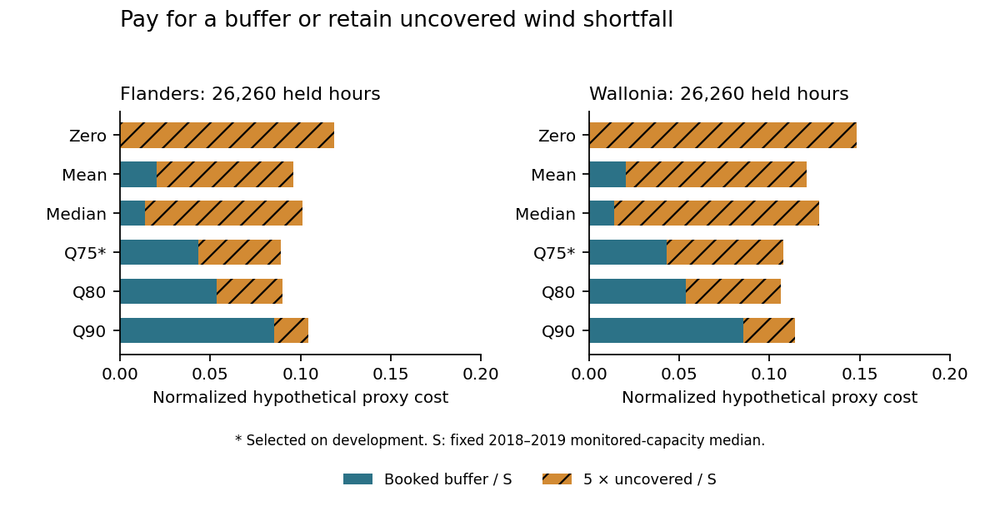

# Budget a buffer for day-ahead wind shortfalls

A planner booking a buffer against wind forecast shortfalls faces two costs: unused buffer and uncovered shortfall. This study makes that tradeoff explicit using historical Elia onshore forecasts and reported generation. Its capacity limits and shortfall penalties are **hypothetical scenarios**, not measured operating costs.

**Finding:** the development-selected Q75 buffer lowers the primary proxy cost from **117.120 to 87.820** in Flanders and **103.987 to 75.474** in Wallonia. Each region has 26,260 eligible held hours. Coverage is **79.954% and 75.091%**, respectively. The fixed mean-bias correction worsens held point-forecast MAE in both regions. A lower modeled shortfall cost and a better point forecast are different results.

**What changes the decision:** when the uncovered-shortfall penalty falls from five times to twice the buffer cost, the selected Q75 buffer costs more than booking zero in both regions. Q80 has a slightly lower primary held proxy cost in Wallonia than Q75; the frozen development choice is retained. No grid reliability improvement, actual reserve dispatch or financial saving was measured.

Read the [independent seven-page manuscript](paper/manuscript.pdf), [fixed protocol](PROTOCOL.md), [source attribution and rights](DATA_RIGHTS.md), [all development candidates](results/development_search.json), [all held policy scenarios](results/held_policy_metrics.json) and [independent held checks](results/independent_held.json).

## Reproduce and inspect

Use Python 3.12, install `requirements.txt` and run `python src/reproduce.py`. It makes a temporary local Git clone, rebuilds the calendar and hourly inputs, fits the declared rules, recomputes all development/held results, runs independent checks and 30 finite synthetic fixtures, and compares 21,916,240 CSV fields including headers plus eight JSON documents. Original exports remain unchanged; no source network is used during replay.

The compressed policy predictions retain each timestamp, region, rule, cap, exact booked buffer, uncovered shortfall, excess and event flag. For any declared penalty, reconstruct per-hour loss as `reserve + penalty * uncovered`. Predictions are stored once per cap because the penalty changes the score, not the booked action. Point forecasts and every exclusion remain separately exported. Figure, manuscript and canonical Git checks are listed in the Linux workflow. Public replay uses the captured projections; full two-format source reconciliation also needs the privately retained original exports.

## Boundaries that matter

The data contain 420,672 quarter-hour records from Flanders and Wallonia DSO-connected onshore wind in 2018–2023. The calendar gate retains missingness and integrates an hour only if all four slots pass. Forty planned hours are unavailable; there is no interpolation or zero filling. Flanders 2018–2019 errors fit the six rules; Flanders 2020 selects one; 2021–2023 supply temporal and geographic held outcomes. Earlier Wallonia capacity covariates set its physical reference scale, while its error labels remain outside fitting and selection. Twenty-nine dependencies were committed before held summaries.

Source: **Elia Transmission Belgium SA**, [historical wind dataset ods031](https://opendata.elia.be/explore/dataset/ods031/information/), under the [Elia Open Data License](https://opendata.elia.be/pages/licence/) applying [CC BY 4.0](https://creativecommons.org/licenses/by/4.0/). Changes: minimal projection, quality/calendar flags, hourly averaging and hypothetical policy calculations. No endorsement is implied.

Reported measured-and-upscaled generation is not independently validated metering. Source-labeled day-ahead 6 PM forecasts do not establish an original issuance-version receipt; current historical records may be revised. Offshore discrepancies noted by Elia are disclosed, and offshore is excluded. Curtailment, capacity changes, serial dependence and the two-region cohort limit interpretation. There is no dispatch, ramp or storage-duration model, measured market price, significance claim or new estimator. The manuscript is an independent program paper, not peer reviewed. Formal-publication projects, including Azure optimization, remain private.
